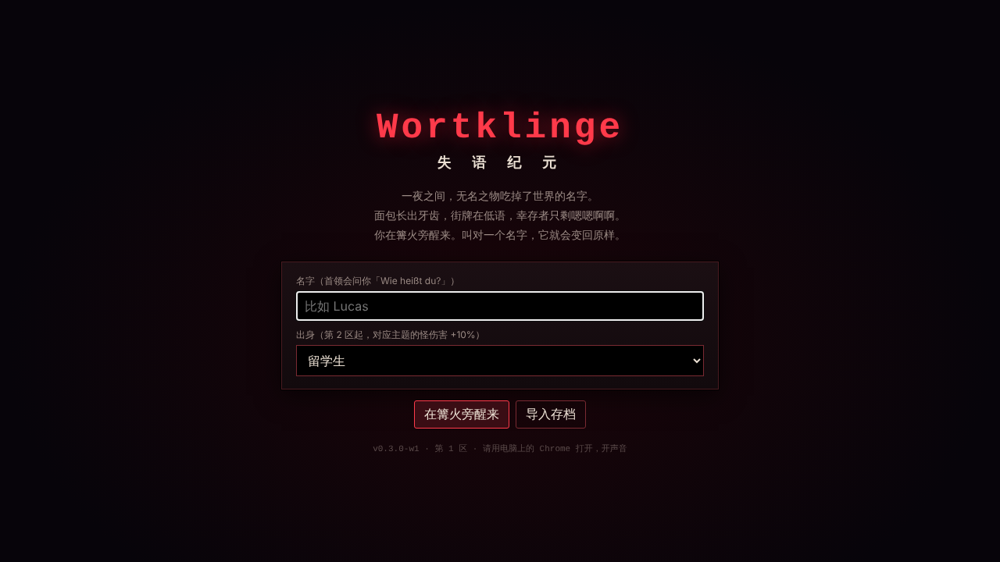
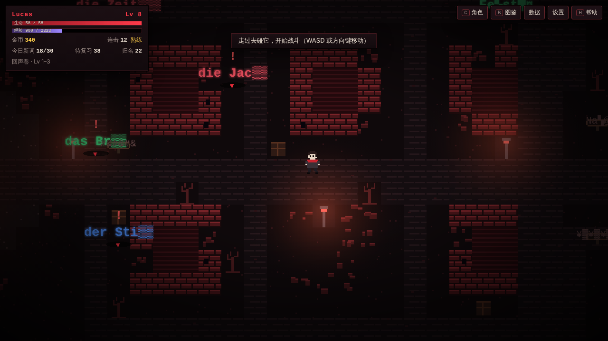
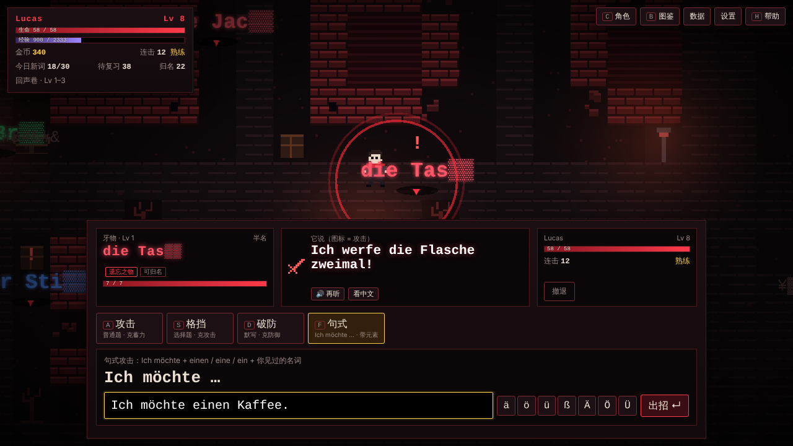

<div align="center">

# 失语纪元 · Wortklinge

**暗黑像素 RPG：每只怪物都是一个德语词。叫对它的名字，它才会变回原样。**

*A dark pixel RPG where every monster is a German word. Call it by its true name to turn it back.*

[**▶ 在浏览器里玩 / Play in your browser**](https://laurence1997.github.io/wortklinge/) · 电脑 Chrome，开声音 / desktop Chrome, sound on



</div>

[中文](#中文) · [English](#english)

---

## 中文

一夜之间，「无名之物」吃掉了世界的名字。面包长出牙齿，街牌在低语，幸存者只剩嗯嗯啊啊。你在篝火旁醒来，带着一个来历不明的「系统」：**叫对一个名字，它就会变回原样。**

这是一个给中文母语者学德语的网页游戏。它不是套了皮的单词卡：打怪、刷装备、读怪物的意图，这些动作本身就是在用德语。



### 核心玩法

- **一个词就是一只怪。** 名词要带冠词叫：`der Tee`，不是 `Tee`。
- **归名。** 同一只怪要在三次不同的重生里打败它（当天、隔天、再过两天），最后一下还要默写出带冠词的全名，它才会褪掉牙、变回原来的东西。这就是间隔重复，但你看到的是怪物一层层变回原样，不是一个百分比。
- **多学不吃亏。** 新词没有每日上限，收益也不打折。今天见过的词会按时以复习怪回来，按时打掉经验 ×1.5，多给一片装备碎片。
- **读意图就是读德语。** 怪物先用德语说出它下一步要干什么：`Ich beiße dreimal!`（我咬三下）、`Moment!`（在蓄力）、`Ich greife jetzt nicht an.`（这回合不打）。读懂了，才知道该攻击、格挡还是破防。你先出手：这一下打死它，它的打算就作废。
- **冠词决定元素。** 句式攻击 `Ich möchte einen / eine / ein …` 里用了什么性的名词，这一击就是什么元素：der 冰、die 火、das 毒。想玩火系，就得会一批阴性名词。
- **魂类篝火。** 篝火旁休息，到期的词重新长出牙。死了不丢学习进度，但金币和经验会留在杀死你的那个词身上，回去打败它才能捡回。
- **首领是一场真对话。** 第 1 区首领「无名的邻居」会限时问你叫什么、从哪来、住在哪：用完整的德语句子回答它。问法每次随机，背不了答案。



### 0.6：新内容

- **第 3 区「铁轨镇」，21–30 级。** 车站、问路、时间、看病和失物招领，约 230 个新词；动词怪开始说现在完成时，选 haben 或 sein 相。首领「晚点之王」和检票员 Lina 的支线。
- **场景记忆法。** 每个场景一张小插画和一组固定的词，词学到半名，画里对应的东西就亮起来；一组词全到半名掉一页邻居的日记，填回去还能读出来。
- **21–30 级的新系统。** 驿站传送、每日委托、秩序会登记表（用 Sie）、眼镜、紫装德语鉴定、刻字孔（auch / denn）、怪物诅咒、盲盒摊、锈名怪、零号站台规则地下城、A1 突破试炼、终极技能（句型填空）。
- **头像和图标。** 对话头像、怪物图和装备图标。
- **物品栏（0.6.3）。** 低语不再占出手位，改成答题时用的「低语纸条」（按 W，打字时按 ?）；新加回血的「药片」（按 H，占一回合）。纸条回篝火补到 3 张，两样都能掉落、能在商店用德语买；终结技攒满言灵才出现在招式栏。
- **开宝箱动画（0.6.4）。** 宝箱抖一下再开盖，按开出的最好品质亮光，东西一件件飞出来；铁箱、金箱的言灵锁写对时，每件装备当场翻出两次品质、留下好的那次。出传说时全屏红光一闪。任意键跳过，设置里可以关。只改表现，掉率和数值不变。
- **野外精英（0.6.5）。** 9 级起，一个场景的词有一半到了半名，就会出一只场景精英（◈）。它带这个场景的 3 个词，分 3 段连着打：先认（选择题）、再用（例句填空）、最后写（默写），中间不回血；每段按普通怪 ×1.2 结算，第一次打赢必掉铁箱。打赢后，这个场景有 3 个词到期复习时它会再来。原来 15 级的族群猎手取消，B1 之前没有红名怪。
- **写作和词表导入（0.6.6）。** 可以导入别的软件的词表（CSV、Language Reactor 的 xlsx），对上的词在它的场景里先出。7 级起排句（把打乱的几块排成一句）、9 级起槽位造句（用单词本里任何合适的名词回答）、14 级起连句终结技（und / oder / aber / denn，23 级加 weil / dass / wenn）、16 级起篝火日记（用今天打过的词写两三句，只提示查得出的错，不判对错）。
- **回音怪（0.6.6）。** 5 级起，有「最小对立词」的怪（Tür / Tier、schon / schön）有时会考这两个词：默认听它读、选是哪个；在设置里打开「发音训练」下载约 635 MB 的发音模型后，音色和辅音组可以按住空格读出来打它，录音只在本机处理。读错不耗回合、不罚，会放示范和你的录音对比。长短音组只做听辨。
- **一天内归名和语境复习（0.6.7）。** 一个词认、用、写三场就能归名，打散后约 6 分钟在本场景重生；第一场全对且有打字题就直接到半名。归名之后不再定期回来当怪，而是 2 天、1 周、1 个月、3 个月各在你正在打的战斗里插一道例句填空（答对破甲、多一片碎片，答错才复发成复习怪）；一路没错没提示的词只在 30 天后抽查一次；在任何地方写对它都算复习过。群怪改成同冠词成对，齐鸣只在目标选对相时响，打同相的那几只。

### 0.5：新内容

- **词性三相。** 出手前选 der / die / das 相，选对打中弱点；7 级起要按怪那句话里缺的位置选变格后的冠词（den、einen……），15 级起加第三格。
- **句子怪「残句」。** 金色名牌，三步打散：接下半句、选意思、写整句，掉短句卡。
- **跟读。** 5 级起答对后可以跟着读那句德语（只支持电脑版 Chrome 的语音识别），读得像多给经验。
- **大地图和小世界。** 一站一站点着走，每个区域有一条读懂路牌才出现的隐藏支线；按 M 打开大地图。
- **开局 60 分钟。** 装备、铭刻和低语、终结技提前到 3、4、5 级，每个新系统一场教学战；成就和剧情纸条。

只支持电脑版 Chrome。

### 0.3：已经能玩的内容

第 1 区「余烬营地」，1–10 级，202 个 Goethe A1 词（问候、自我介绍、数字、家人、营地物品）：

| 等级 | 开放 |
| --- | --- |
| 1 | 词性三相：出手前选 der / die / das 相，选对护甲降一档（6 级前选错不罚）；连击和暴击、台词朗读 |
| 2 | 打字默写，ä ö ü ß 按钮（也接受 ae oe ue ss） |
| 3 | 篝火、遗忘刷新、归名进度；装备：笔、外套、护符、词典；接句怪和残句 |
| 4 | 死亡和回响；铭刻、低语；言灵开始攒 |
| 5 | 终结技；跟读（可选，Chrome 语音识别） |
| 6 | 规则动词变位；选错相开始受罚；相决定元素 |
| 7 | 格挡和破防 |
| 8 | 首领「无名的邻居」、句子技能、紫装和传说装备；怪物会回血 |
| 9 | 意图里的否定：`nicht` |

打败邻居、到 10 级以后，邻居家的门通向第 2 区「面包集市」，11–20 级，约 200 个新词（食物、购物、价格、数字到 1000、购物动词）：

| 等级 | 开放 |
| --- | --- |
| 10 | 导师 Greta 的职业试炼：书写者（墨水、默写暴击、墨水风暴）或守护者（沉着、答错少挨打、稳住） |
| 11 | 商人 Mira：买东西要说 `Ich nehme den Mantel.`，还能讲价；宝箱和言灵锁；喊着 `Ich muss los!` 想逃的宝箱怪；群怪和齐鸣（只打和你同相的怪）；复数怪（`die Äpfel`，只吃 die 相） |
| 12 | 不规则动词也要写变位（`du nimmst`、`er nimmt`）；天赋树；任务面板（J）和面包师傅 Konrad 的支线 |
| 13 | 意图带对象：`Ich kratze dich!` 打你，`Ich kratze mich.` 挠它自己；三只一群的群怪 |
| 18 | 首领「吞秤者」：看价签和数量，用德语说出价格（`Das Brot kostet zwei Euro fünfzig.`） |

### 设计原则

- **学习进度永远不丢。** 死亡、断签都不会拿走你学会的东西。
- **奖励只靠说对、写对拿到。** 刷宝链上的每个动作都是答德语。
- **判题和出招用规则，不用 AI。** 每个判定都可以复现、可以解释，答错会告诉你错在哪（冠词？变音？少一个字母？）。
- **会用，不是会考。** 词和句子按生活场景挑选，Goethe 词表只当底线。

### 技术

- **Phaser 3** 负责地图、角色和特效；背包、对话和打字作答用网页元素叠在画面上（中文输入法和 ä ö ü 更好处理）。
- **纯 TypeScript 的规则核心**（`src/core`）和画面完全分开：战斗、归名、判题、掉落都能单独测试和模拟。
- **素材**：篝火、路牌、光效和标记在代码里画；0.6 起每个场景的小插画用 [Kenney](https://www.kenney.nl) 的 1-Bit Pack 图块拼成（CC0，`public/art/`，许可见 `public/art/kenney-1bit-LICENSE.txt`）；主角、NPC、怪物（地图和战斗）、对话头像和装备图标用 Kenney 的 Tiny Dungeon（CC0，许可见 `public/art/kenney-tiny-dungeon-LICENSE.txt`），统一染成红色，只有主角的头发保留玩家选的颜色；0.6.x 起小世界地图的地面、墙和树用 Kenney 的 Tiny Town 图块铺（CC0，许可见 `public/art/kenney-tiny-town-LICENSE.txt`），压暗成红黑色调；音乐是 Web Audio 实时合成的低沉氛围音和心跳；台词用浏览器自带的德语语音。
- **德语校对**：所有德语句子每次改动都自动过 [LanguageTool](https://languagetool.org)，可选再让 DeepSeek 复查；母语例句候选来自 [Tatoeba](https://tatoeba.org)（CC BY 2.0 FR，采用的句子保留编号和作者）；玩家可在答题后点「这句有问题？」报错。详见 `proof/README.md`。
- 存档在浏览器本地，可导出、导入；没有服务器，没有账号。

```
src/
  core/      规则：战斗、意图、归名、判题、掉落、存档（不依赖画面）
  data/      词表、怪物族群、意图说法、首领问题、句子技能
  game/      Phaser 场景、地图生成、像素图、音频、控制器
  ui/        HUD、战斗面板、首领舞台、角色与图鉴面板
test/        规则测试（Vitest）
scripts/     数值模拟
```

### 本地运行

```bash
npm install
npm run dev        # http://localhost:5173 ，加 ?dev=1 打开调试按钮（+1 天、+1 级）
npm test           # 规则测试
npm run build      # 打包到 dist/
npx vite-node scripts/sim.ts   # 不同正确率下的战斗数值模拟
```

### 德语内容

词表和台词由 AI 起草，按规则自动检查，仍需母语者校对。发现不地道或错误的地方，欢迎提 Issue。

---

## English

Overnight, the *Nameless* ate the names of the world. Bread grew teeth, street signs whisper, and survivors can only mumble. You wake by a bonfire with a mysterious "System": **say a thing's true name and it turns back into itself.**

A browser game that teaches German to Chinese-speaking learners. It isn't flashcards in a costume: fighting, looting and reading monster intents are themselves German practice.

### How it plays

- **Every monster is a word.** Nouns must be called with their article: `der Tee`, not `Tee`.
- **Naming (归名).** Defeat the same word on three separate respawns (today, tomorrow, two days later), and land the last blow by typing its full name with the article. Only then does it shed its teeth and turn back into a cup or a chair. It's spaced repetition you can *see*.
- **Learning more never pays less.** New words have no daily cap and no reduced rewards. Words you meet come back as review monsters on schedule; beating one when it is due gives ×1.5 XP and an extra gear shard.
- **Reading intents is reading German.** Monsters announce their next move in German: `Ich beiße dreimal!` (bites three times), `Moment!` (charging), `Ich greife jetzt nicht an.` (not attacking this turn). Read it right to choose attack, block or guard-break. You act first, so a kill cancels its move.
- **Articles are elements.** In `Ich möchte einen / eine / ein …` sentence attacks, the noun's gender sets the element: masculine = ice, feminine = fire, neuter = poison.
- **Souls-like bonfires.** Resting respawns the words that are due. Dying never costs learning progress, but your gold and XP stay on the word that killed you until you win them back.
- **Bosses are real conversations.** The first boss, *The Nameless Neighbour*, asks who you are and where you're from, on a timer, in randomised phrasings. Answer in full German sentences.

### Version 0.6

- **Region 3, Gleisdorf, levels 21–30**: stations, directions, time, the doctor and lost-and-found, about 230 new words; verb monsters start speaking in the Perfekt (pick the haben or sein stance). Boss "the King of Delays" and Lina's side story.
- **Scene memory**: every scene has a small picture and its own set of words that light up as you learn them; finishing a set drops a page of the neighbour's diary to fill in and read aloud.
- **New systems from 21 to 30**: waystation travel, daily tasks, the registry office form (formal Sie), glasses, German item identification, engraving sockets (auch / denn), monster curses, a blind-box stall, rusty review monsters, the Platform Zero rule-card dungeon, the A1 breakthrough exam and the ultimate skill (fill a sentence frame).
- **Portraits and icons** for speakers, monsters and gear.
- **Item bar (0.6.3)**: the whisper hint is no longer a move but a consumable note you use after seeing the question (W, or ? while typing); a new tablet heals but spends the turn (H). Notes refill to 3 at a bonfire; both drop from monsters and can be bought in the shop with a German sentence. The finisher button only appears when its bar is full.
- **Chest animation (0.6.4)**: chests shake, open and glow in the best quality's colour while the items pop out one by one; with the 言灵锁 written right each item shows both quality rolls and keeps the better one. An orange flashes the screen red. Any key skips; it can be turned off in the settings. Presentation only, rates and numbers are unchanged.
- **Field elites (0.6.5)**: from Lv9, once half of a scene's words are 半名 the scene sends an elite (◈). It carries three of the scene's words in three back-to-back parts: recognise (choice), use (cloze), write (typing), with no heal in between; each part pays ×1.2 a normal kill and the first win always drops an iron chest. After that it returns whenever three of the scene's words are due. The old Lv15 族群猎手 is dropped; there are no red-name monsters before B1.
- **Writing and word-list import (0.6.6)**: import a word list from another app (CSV, or Language Reactor's xlsx) and the matching words come first in their scenes. From Lv7 put shuffled chunks into a sentence, from Lv9 answer a slot with any fitting noun from your wordbook, from Lv14 a finisher joins two sentences (und / oder / aber / denn, plus weil / dass / wenn at Lv23), and from Lv16 a bonfire journal (two or three sentences with today's words; only sure mistakes are pointed out, nothing is graded).
- **Echo monsters (0.6.6)**: from Lv5, monsters whose word has a minimal-pair partner (Tür / Tier, schon / schön) sometimes ask which of the two it is. By default you hear one and pick; with 发音训练 on in the settings (a ~635 MB phoneme model, recordings stay on your computer) you read sound-quality and consonant pairs aloud. A misread costs no turn and plays the model voice next to your recording. Length pairs are listen-only.
- **归名 in a day and context reviews (0.6.7)**: a word is named after three fights (recognise, use, write), respawning in its scene about 6 minutes after each; a flawless first fight with a typed answer jumps straight to 半名. Named words no longer come back as monsters on a schedule: after 2 days, 1 week, 1 month and 3 months one cloze from its example sentence is slipped into whatever fight you are in (right breaks armor and gives a shard; wrong relapses it to a review monster). A word named without a single mistake or hint gets one 30-day check only, and writing it right anywhere counts as a review. Packs now come as same-article pairs, and 齐鸣 rings only when the target's stance is right, hitting the monsters of that stance.

### Version 0.5

Stances (pick der / die / das before you strike; from level 7 the declined article the monster's line is missing), sentence monsters that drop phrase cards, optional read-along with Chrome speech recognition, a point-and-click scene map with hidden side routes, and a reworked first hour (gear, skills and the finisher open at levels 3, 4 and 5, each with a teaching fight). Desktop Chrome only.

### Version 0.3

Region 1 (levels 1–10, 202 Goethe A1 words) and Region 2, the Bread Market (levels 11–20, about 200 words on food, shopping and prices). Region 2 adds two classes with trials and talent trees, a shop where you buy by saying `Ich nehme den Mantel.` (and haggle), chests with a word lock, treasure monsters that run off shouting `Ich muss los!`, monster packs you target by calling out their article, plurals (`Ich nehme zwei Äpfel.`), present-tense verb conjugation, `mich`/`dich` in monster intents, a baker's side quest, and a boss who only asks prices and quantities.

### Tech

Phaser 3 for the world, a DOM overlay for typing and menus, and a pure TypeScript rules core (`src/core`) that is fully testable and simulatable without rendering. Fire, signs, glow and markers are drawn in code; since 0.6 each scene's small illustration is built from Kenney's 1-Bit Pack tiles ([kenney.nl](https://www.kenney.nl), CC0, see `public/art/`), and the hero, NPCs, monsters (map and battle), portraits and gear icons come from Kenney's Tiny Dungeon (CC0), recoloured red except the hero's hair colour; since 0.6.x the small-world map's ground, walls and trees are Kenney's Tiny Town tiles (CC0), darkened to red and black. Music is synthesised with Web Audio, and lines are spoken with the browser's German voice. Saves live in `localStorage` with export/import. No server, no account.

```bash
npm install && npm run dev    # add ?dev=1 for debug buttons
npm test
```

German content is AI-drafted and checked automatically (LanguageTool on every change, optional DeepSeek cross-check, native example candidates from [Tatoeba](https://tatoeba.org), CC BY 2.0 FR; see `proof/README.md`). Players can flag a sentence in game; native-speaker corrections are very welcome as issues.

## License

MIT
